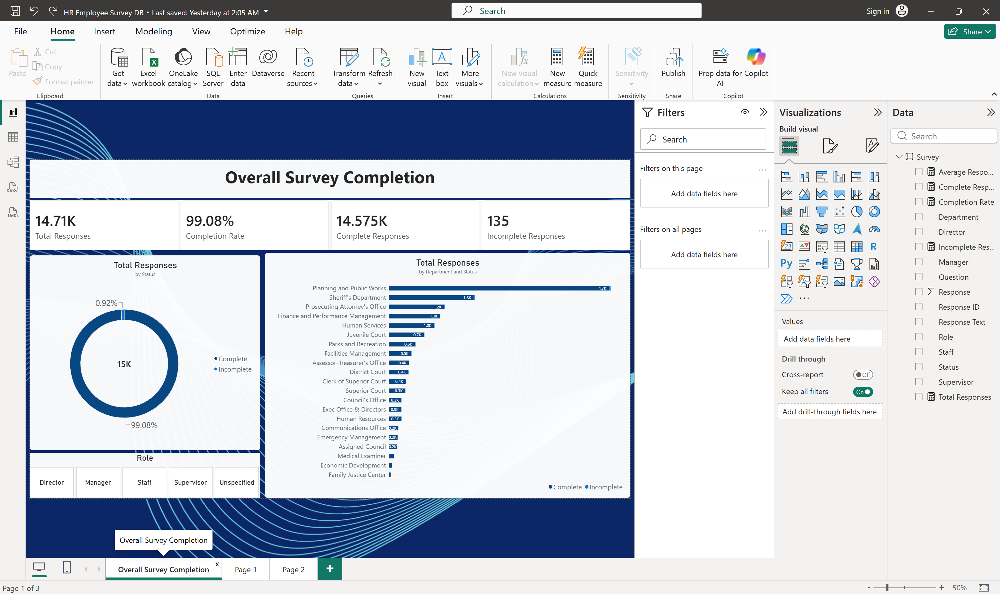
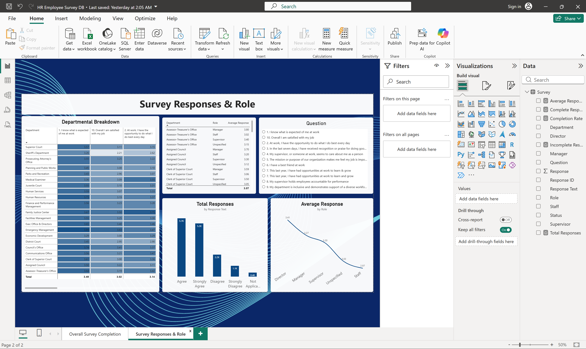

# HR Employee Survey – Power BI

Power BI dashboard for an HR employee survey, built for the **Data Analysis & Business Intelligence Diploma** at **IMP**.

## Overview

This project visualises employee survey responses in Power BI. The report pages (from the `.pbix` layout / screenshots) include:

- **Overall Survey Completion**
- **Survey Responses & Role** (also labelled Survey Responses & Insights in earlier drafts)

Included files:

- `HR_Employee_Survey_DB.pbix` — Power BI report
- `HR_Employee_Survey_Responses.xlsx` — survey response source data
- `docs/screenshots/` — report page screenshots from Power BI Desktop

Responses are Likert-style survey answers by department; the workbook does not include personally identifying respondent contact details.

## Screenshots

| Overall Survey Completion | Survey Responses & Role |
|---|---|
|  |  |

## Key findings

Computed from `HR_Employee_Survey_Responses.xlsx` (sheet `HR Survey Reponses`) and consistent with the report visuals:

- **14,725** answer rows (**14,710** unique Response IDs in the model); **14,590 Complete** / **135 Incomplete** → about **99.1%** completion (report card: **99.08%**).
- **21 departments**; largest volumes: Planning and Public Works (**4,703** rows), Sheriff's Department (**1,821**), Prosecuting Attorney's Office (**1,182**).
- Among complete, applicable Likert answers, overall mean score ≈ **3.07** (scale reflected in Response 0–4 style values in the sheet).
- **Highest-scoring departments (mean Response):** Family Justice Center **3.61**, Emergency Management **3.48**, Exec Office & Directors **3.47**, Communications Office **3.40**, Human Resources **3.35**.
- **Lowest-scoring department:** Sheriff's Department **2.46** (n≈1,755).
- **Highest-rated question:** “I know what is expected of me at work” (mean ≈ **3.49**).
- **Lowest-rated questions:** “I have a best friend at work” (≈ **2.60**) and recognition in the last seven days (≈ **2.81**).
- Response text mix (complete rows): Agree **5,737**, Strongly Agree **5,236**, Disagree **2,162**, Strongly Disagree **1,061**, Not Applicable **394**.
- Role visuals in the report show Staff as the largest share of tagged responses; average response by role trends higher for Director / Manager than Staff (see screenshots).

Visual types used on the pages include cards, donut/pie, bar/column charts, slicers, and tables (including a “Departmental Breakdown” pivot-style visual).

## Tools

- Microsoft Power BI Desktop
- Microsoft Excel (source workbook)

## How to open

1. Clone or download this repository.
2. Open `HR_Employee_Survey_DB.pbix` in **Power BI Desktop**.
3. If the data source needs updating, point it at `HR_Employee_Survey_Responses.xlsx` in this folder and refresh.

> Additional page exports (File → Export → or screenshot each page) can be dropped into `docs/screenshots/` if you want every visual captured outside Power BI Desktop.

## Credit

**Data Analysis & Business Intelligence Diploma | IMP | Expected Dec 2026**
